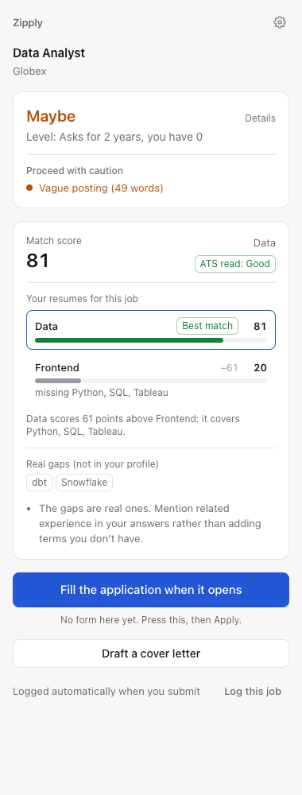
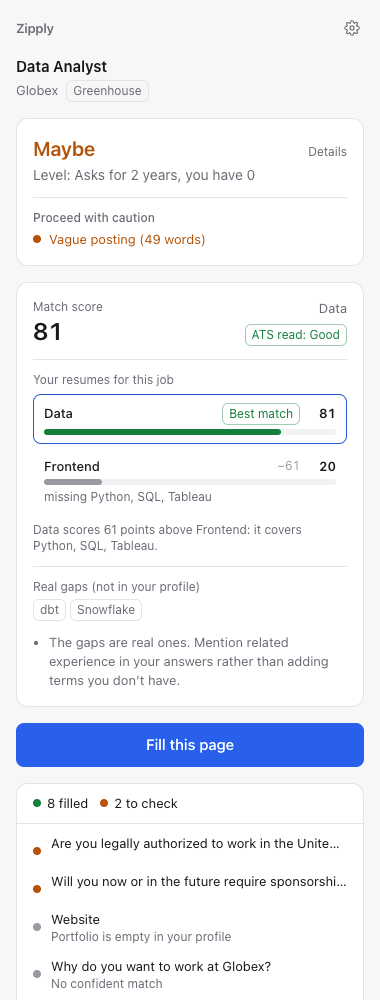
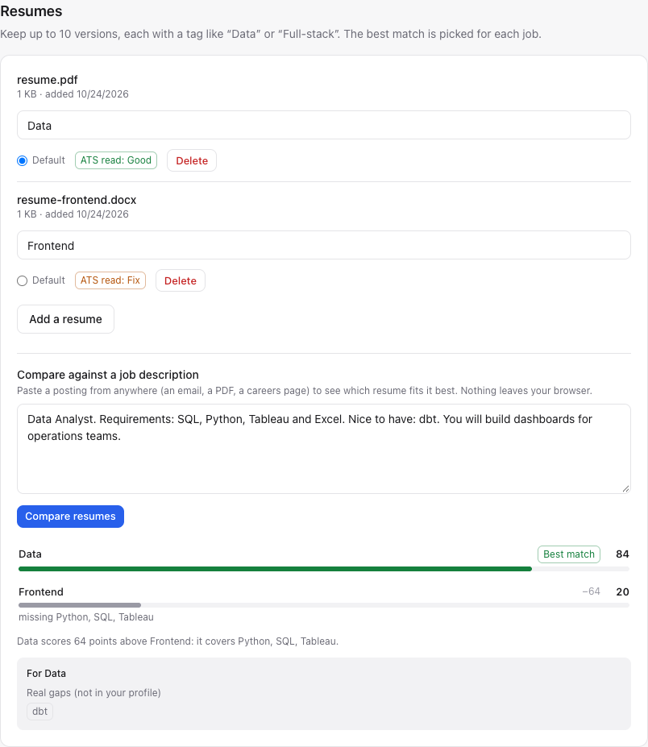

# Zipply

**Zip through job applications.** Zipply is a free Chrome extension that fills out job applications from one saved profile, tells you whether a job is worth applying to before you start, and keeps a Google Sheet of everything you've applied to, updated from your email.

It works on Workday, iCIMS, Greenhouse, Lever, Ashby and companies' own application forms. It never submits anything for you.

Built by [Maazin Shaikh](https://www.linkedin.com/in/maazin-shaikh).

<p align="center">
  
  &nbsp;&nbsp;
  
</p>

## What it does

- **Fills applications for you.** Press one button and Zipply fills names, contact details, work history, education, links, your resume file and the standard questions. Multi-page applications keep filling as you go.
- **Follows the job through "Apply".** Read a posting on LinkedIn, Indeed or a careers page, press **Fill the application when it opens**, then click the site's Apply button. The form fills as it loads, even on another site or in a new tab.
- **Tells you if a job is worth it.** Every posting gets an **Apply**, **Maybe** or **Skip** verdict, a match score, the skills you could add to your resume, the gaps you shouldn't fake, red flags, and a warning if you've already applied.
- **Picks the right resume.** Keep up to 10 resumes. Zipply scores all of them against each job and suggests the best one, with what the others are missing.
- **Shows scores while you browse.** On LinkedIn and Indeed, a small score appears next to each job you open, so you can skip bad fits early.
- **Keeps your tracker up to date.** Each application you submit is added to a Google Sheet with a dashboard. Optional Gmail sync moves each one along (Received, Interview, Offer, Rejected) as replies come in.
- **Drafts answers that sound like you.** Optional AI drafts for "Why do you want to work here?" and cover letters: specific, in plain first person, built from your real experience and checked for anything your profile doesn't support.

## What it won't do

- **It never clicks Submit** or Next. You review and send every application yourself.
- **It never guesses sensitive answers.** Work authorization, sponsorship, salary and demographic questions are filled only from answers you saved. Otherwise they're left empty and flagged. Consent checkboxes are never ticked.
- **It never sends your personal details to an AI service.** The free cloud AI sees field labels and a profile with your name, contact details, salary and demographic answers removed.
- **It doesn't cost anything.** No subscription and no server. Your data stays in your browser and your own Google account.

## Contents

- [Install](#install)
- [Set up your profile](#set-up-your-profile)
- [Optional: free AI drafts](#optional-free-ai-drafts)
- [Optional: Google Sheets tracker and Gmail updates](#optional-google-sheets-tracker-and-gmail-updates)
- [Using Zipply](#using-zipply)
- [Updating](#updating)
- [Troubleshooting](#troubleshooting)
- [Privacy and security](#privacy-and-security)
- [How it works](#how-it-works)
- [Development](#development)
- [Credits](#credits)

## Install

Zipply isn't in the Chrome Web Store, so you build it once on your computer. It takes about 10 minutes.

**You need:** desktop Chrome 120 or newer, [Node.js](https://nodejs.org/) 20.19 or newer, and [Git](https://git-scm.com/downloads). On Windows, run the commands below in **Git Bash**.

1. Download the code:

   ```bash
   git clone https://github.com/maazin/Zipply.git
   ```

   ```bash
   cd Zipply
   ```

2. Give your copy a permanent ID. This keeps the extension's ID the same every time you rebuild, which Google sign-in depends on:

   ```bash
   sh scripts/make-key.sh
   ```

   It prints your **Extension ID**. Keep it handy if you'll set up Google Sheets. It also creates `zipply.pem`: back that file up and don't share it.

3. Install and build:

   ```bash
   npm install
   ```

   ```bash
   npm run build
   ```

4. Load it into Chrome:
   1. Go to `chrome://extensions`.
   2. Turn on **Developer mode** (top right).
   3. Click **Load unpacked** and choose the `dist` folder inside `Zipply`.

5. Pin it: click the puzzle-piece icon in Chrome's toolbar and pin **Zipply**. Your Profile page opens automatically.

Chrome will say Zipply can "read and change all your data on all websites". That's because job applications can be on any site. [Here's exactly what it does with that.](#privacy-and-security)

## Set up your profile

Everything here is on the **Profile** page. To get back to it, right-click the Zipply icon and choose **Profile**, or use the gear in the side panel. Changes save automatically.

1. **Drop in your resume** at the top of the page. Zipply reads it in your browser and fills in your basics, experience, education and skills. Check them over and fix anything it misread.
2. **Standard answers.** Answer the questions most applications ask: work authorization, sponsorship, willingness to relocate, start date, salary expectation, and the optional demographic questions. Zipply only ever fills these from what you enter here.
3. **Resumes.** Add up to 10 versions and give each a short tag, like "Data" or "Frontend". The tag is how Zipply refers to them when it picks the best one for a job. Each resume also gets an **ATS read** grade showing whether hiring software can read it. Click the grade for the details.
4. **Filters** (optional). Set the scores that count as Apply and Maybe, your minimum salary, and the locations you'd work in. You can also list companies and words that rule a job out.
5. **Writing samples** (optional). Paste two or three answers you've written yourself. AI drafts will copy your style: sentence length, tone and word choice.
6. **Passphrase** (optional, under **Privacy and data**). Your data is always encrypted. With a passphrase, it's locked until you type it once per browser session.

**Status**, at the top of the Profile page, shows what's working and what still needs setting up.

## Optional: free AI drafts

Zipply works without any AI. With it, Zipply also maps unusual form fields, drafts open-ended answers and cover letters, and suggests resume wording. It uses only free options.

1. Get a free key at [Google AI Studio](https://aistudio.google.com/apikey). Use a Google Cloud project **without billing**, so you can never be charged.
2. On the Profile page, under **Connections**, paste it into **Gemini API key**.

Zipply counts its calls and stays under the daily limits shown there. When they run out, it uses Gemini Nano, which is built into Chrome on laptops that can run it, and after that leaves the field for you.

## Optional: Google Sheets tracker and Gmail updates

To log applications to a Google Sheet, your copy of Zipply needs its own free Google sign-in. Google requires this for every extension that isn't in the Web Store. It takes about 15 minutes, once. Without it, Zipply still fills and scores everything; your applications just wait in a local queue.

1. Open the [Google Cloud Console](https://console.cloud.google.com/) and create a new project. Don't add billing.
2. Go to **APIs & Services → Library** and enable the **Google Sheets API**. If you want status updates from your email, also enable the **Gmail API**.
3. Set up the **OAuth consent screen** (shown as **Google Auth Platform** in newer versions of the console):
   1. Choose **External** and name the app "Zipply".
   2. Under **Audience** (or **Test users**), add your own Gmail address as a test user.
4. Go to **Credentials → Create credentials → OAuth client ID**.
   1. For **Application type**, choose **Chrome Extension**.
   2. For **Item ID**, paste the Extension ID that `make-key.sh` printed. It also appears on Zipply's card in `chrome://extensions`.
   3. Create it and copy the **Client ID**.
5. Open the file named `.env` in the Zipply folder and add this line, with your Client ID in place of the example:

   ```
   VITE_GOOGLE_CLIENT_ID=1234567890-abc123.apps.googleusercontent.com
   ```

6. Rebuild. Zipply reloads itself within a minute:

   ```bash
   npm run build
   ```

7. On the Profile page, under **Connections**, click **Sign in with Google** and approve. Google will warn that the app isn't verified; that's expected for your own private copy, so continue.

Zipply creates one sheet, **Zipply applications**. It can only see files it created, nothing else in your Drive. To get status updates from email, turn on **Update statuses from Gmail** in the same section. Gmail access is read-only.

Because your Google app stays in "Testing", Google may ask you to sign in again from time to time. Status will tell you when.

## Using Zipply

Open the side panel by clicking the Zipply icon, or press `Alt+Shift+F`.

### Browse jobs

On LinkedIn and Indeed, open any job and a small score appears next to its title and on its card in the list, for example **78 · Apply · Data**. That's the score, the verdict, and your best resume for it. Hover for the other resumes' scores. Only jobs you open are scored, and you can turn this off under **Connections**.

### Check a job before applying

Open the panel on any job posting. You'll see:

- **The verdict.** Apply, Maybe or Skip, with the reason. Click **Details** to see the four checks: role fit, level, logistics and pay.
- **Red flags.** For example: posted a long time ago, no salary range, a vague description, or you already applied for this title recently.
- **The match score** for the selected resume, the skills you have that the resume doesn't mention (**Can add**), and the real gaps.
- **Your resumes, ranked** for this job, with a line on why the best one wins. Click another resume to use it instead.

Skip is advice. It never stops you from filling an application.

### Apply

- **From a job posting:** press **Fill the application when it opens**, then click the site's Apply button. The form fills as soon as it loads, in the same tab or a new one.
- **On an application form:** press **Fill this page**.

The panel then lists every field:

- **Green:** filled.
- **Amber:** filled, but worth a look.
- **Gray:** skipped, with the reason.
- **Red:** required but still empty.

Click any row to jump to that field. Multi-step applications keep filling as you move through the steps.

**Draft a cover letter** writes one from the posting and your profile. Copy it, or use **Insert into form** when the application has a cover letter box. When **Draft open-ended answers while filling** is on (under **Connections**), questions like "Why do you want to work here?" get a draft too. Drafts are marked **Draft**, and Zipply flags any claim it couldn't find in your profile.

**If Zipply fills something wrong, just fix it.** It remembers your correction for that question on that site and uses it next time.

### Submit

Review the form and submit it yourself. When the site shows its "thank you" page, Zipply logs the application to your sheet. If it misses one, press **Log this job** in the panel.

### Follow up

With Gmail sync on, Zipply checks your inbox every 2 hours and moves each application forward as replies arrive. Offers are flagged for you; it never acts on them. Anything it can't match is listed for you to sort.

The panel shows one line of news at the bottom, for example **Since last time: 1 offer · 3 status updates · 2 to log**. Click it for details, or **Clear all** to dismiss it.

Open the sheet's **Dashboard** tab for your weekly pace, response rate, interview rate, and which applications are going stale.

### Compare resumes for any job

Got a job description by email or in a PDF? Paste it under **Resumes → Compare against a job description** to see your resumes ranked for it.

<p align="center">
  
</p>

## Updating

From the Zipply folder:

```bash
git pull
```

```bash
npm install
```

```bash
npm run build
```

Zipply notices the new build and reloads itself within about a minute, or as soon as you open its panel or Profile page.

> **Don't click Remove on Zipply in `chrome://extensions`.** Removing an extension deletes its saved data. If you need to reinstall, first use **Export profile** under **Privacy and data**, then **Import profile** afterwards.

## Troubleshooting

**Check Status first.** It's at the top of the Profile page and tells you what's wrong and what to do.

| Problem | What to do |
| --- | --- |
| The panel says "No application form on this page yet" | Wait for the form to finish loading and reopen the panel. If you're on the job posting, press **Fill the application when it opens** and then click Apply. |
| A field was filled wrong | Correct it. Zipply remembers the fix for that site. To help improve Zipply, press **Save form** in the panel. It saves the form with everything you typed removed, which you can attach to a [GitHub issue](https://github.com/maazin/Zipply/issues). |
| An application wasn't logged | Press **Log this job** in the panel, or open **Since last time** and use **Log it**. |
| Applications are "waiting to sync" | You're signed out of Google or offline. Sign in under **Connections**. Waiting rows are sent automatically, and a list there shows what's queued and why. |
| Google sign-in stopped working | Click **Sign in with Google** again under **Connections**. It keeps using your existing sheet. |
| "Your Zipply sheet can't be found" | You deleted or moved the sheet. Restore it from Drive's trash and press **Check again**, or press **Create a new sheet**. Zipply never makes a new sheet unless you ask. |
| No AI drafts | Check the Gemini key under **Connections**. If today's free calls are used up, drafts resume tomorrow. |
| No scores on LinkedIn or Indeed | Make sure **Show match scores on LinkedIn and Indeed** is on under **Connections**, and that you've added a resume. |
| Something else | Press **Copy diagnostics** under **Status** and paste it into a [GitHub issue](https://github.com/maazin/Zipply/issues). It contains no personal details, companies, emails or keys. |

## Privacy and security

- **Your data stays with you.** Your profile, resumes, saved answers and Gemini key are stored in your browser and encrypted with AES-GCM. With a passphrase, the encryption key is derived from it and kept only in memory.
- **What it does on websites.** Zipply runs on every site because applications can be anywhere. On each page it does one quick check for signs of a job application. Pages that don't look like one get nothing more: no reading of forms and no messages sent. Gmail, Google Docs, Drive, Calendar, Meet, YouTube and Google sign-in pages are skipped entirely.
- **What the AI sees.** Gemini's free tier may use prompts to improve Google's products, so nothing personal goes to it. Field mapping sends labels only. Drafts use a profile with your name, contact details, address, salary and demographic answers removed. Your resume text and email content go only to Gemini Nano on your own computer, unless you turn on **Let Gemini's free API classify unclear emails**.
- **What Google access it has.** Zipply can only see the files it created in your Drive. Gmail access is read-only, and only the resulting status and date are kept from each email. Sign-in tokens are handled by Chrome and never stored by Zipply.
- **Where it connects.** The built extension can only connect to Google's sign-in, Sheets, Gmail and Gemini addresses.
- **You're in control.** Export everything or delete everything under **Privacy and data**.

## How it works

<details>
<summary>How fields are matched</summary>

1. **Site adapters.** Workday, iCIMS, Greenhouse, Lever and Ashby each have a module that knows their form markup, including Workday's repeating work-history and education sections.
2. **Rules for any other form.** Each field is compared with each profile item using the field's autocomplete hint, label, aria-label, name, id, placeholder and nearby text, plus a dictionary of synonyms ("Surname" means "Last name"). All fields are matched at once, so two fields can't both claim your phone number.
3. **Your answer bank.** Questions you've answered before are reused, and your corrections on a site come first.
4. **AI mapping** for anything still unclear. It sees labels only and can answer only with a profile field name; your values are filled in locally.
5. **Drafts** for open-ended questions, if you turned on AI. They lead with the answer, give one real example tied to what the posting asks for, and avoid stock phrases. A second check flags anything your profile doesn't support.

Values are entered the way a person types them, so React, Angular and Workday's validation all register them.

</details>

<details>
<summary>How jobs are scored</summary>

Scoring runs in your browser with no AI calls.

| Check | How |
| --- | --- |
| Match score | 55% keyword match, 25% skills coverage, 20% resume sections (Resume-Matcher's weights). Required skills count double. "JS" counts for "JavaScript", but "Java" never matches inside it. |
| Can add / Real gap | A missing skill is **Can add** if it's in your profile or another resume, otherwise a **Real gap**. |
| Verdict | Role fit, level, logistics and pay. **Apply** at 70+ with nothing failing, **Maybe** at 50 to 69 or with one warning, **Skip** below 50 or on a dealbreaker, such as no sponsorship when you need it or a blocked company. Thresholds are editable under **Filters**. |
| Best resume | The highest score wins. A tie goes to the resume covering more of the posting. Within 3 points is called a close call. |
| Red flags | Posted 30+ days ago, the same title applied to within 90 days, no salary or a very wide range, a vague posting, contract wording when you want full-time. These never change the score. |
| Already applied | Same company and job ID or posting address, or "possibly applied" for the same company and a near-identical title within 60 days. |
| ATS read | Whether hiring software can extract your resume's text: a text layer on every page, plain-text email and phone, few broken characters, sensible reading order across columns, standard headings. |

</details>

<details>
<summary>How applications are tracked</summary>

Each submission adds a row with the date, company, job title, location, job ID, site, posting link, the resume you used, the match score, verdict, red flags and status. Duplicates are skipped. Submissions are detected by the site's confirmation page, so a failed submit isn't logged. If Google can't be reached, rows wait in a queue and retry on their own.

The **Dashboard** tab uses plain spreadsheet formulas: applications per week with a chart, an activity calendar, a status funnel, response and interview rates, days to first reply, results by verdict, and stale applications.

Gmail sync searches the last 30 days of mail from hiring systems and from companies in your sheet. It matches each email to one application, and statuses only move forward.

</details>

## Development

```bash
npm test
```

```bash
npm run typecheck
```

```bash
npm run test:e2e
```

- `src/core`: pure logic (field matching, scores, Gmail rules, sheet layout, AI prompts), unit-tested with Vitest.
- `src/content`: the content script. Reads and fills forms, with one adapter per ATS, and follows a job from posting to form.
- `src/background`: the service worker. Google sign-in, Sheets, Gmail, the retry queue and the AI router.
- `src/sidepanel` and `src/options`: the side panel and Profile page (React and Tailwind, light and dark mode).
- `e2e/`: Playwright tests that load the built extension in Chromium and fill saved forms served at their real addresses. `npm run screenshots` regenerates the images in this README.

A form saved with **Save form** can be dropped into `tests/fixtures/captured/` to become a test.

Stack: Manifest V3, TypeScript, Vite with CRXJS, React, Tailwind, Dexie, pdf.js, mammoth, `@google/genai`, Vitest and Playwright.

## Credits

Zipply builds on these open-source projects. Thank you to their authors.

- [Resume-Matcher](https://github.com/srbhr/Resume-Matcher) by srbhr (Apache-2.0): match score formula, whole-word keyword matching and section completeness.
- [career-ops](https://github.com/santifer/career-ops) by santifer (MIT): fit dimensions, apply threshold and posting-legitimacy signals.
- [ai-job-search](https://github.com/MadsLorentzen/ai-job-search) by MadsLorentzen (MIT): ATS text-layer checks, Gmail status phrases and stale-application flags.
- [Auto_job_applier_linkedIn](https://github.com/GodsScion/Auto_job_applier_linkedIn) by GodsScion (MIT): already-applied lookup, company blocklist and word filters.
- [JobSync](https://github.com/Gsync/jobsync) by Gsync (MIT): dashboard metrics and activity calendar.

Ideas, but no code, came from FormFilla, job_app_filler, OpenJobAutofill, fillwright, dear-hiring-manager and OpenResume.

Full license texts are in [THIRD_PARTY_NOTICES.md](THIRD_PARTY_NOTICES.md).

## License

[MIT](LICENSE) © 2026 Maazin Shaikh
